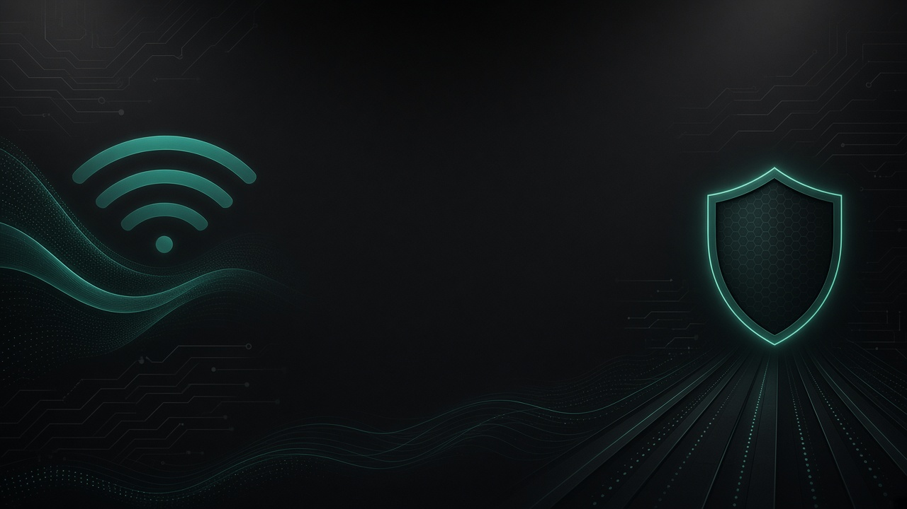

  

<h1 align="center">Xray Wi‑Fi Share</h1>

  <b>Раздай свой VLESS или Hysteria2 как обычную Wi‑Fi сеть</b> 
  Подключай телефон, приставку, ноутбук и другие устройства без установки VPN‑клиента на них.

  
  
  

---

## Как это выглядит

  

## Что делает программа

1. Берёт твою ссылку **VLESS** или **Hysteria2**
2. Поднимает на компьютере отдельный VPN‑туннель
3. Раздаёт его как Wi‑Fi точку через USB‑адаптер
4. Устройства в этой сети ходят в интернет уже через VPN

Компьютер при этом продолжает пользоваться своим обычным интернетом — раздача не «перехватывает» весь ПК.

## Что нужно

- Windows 10 / 11
- USB Wi‑Fi адаптер, который умеет раздавать сеть (SoftAP / hosted network)
- Рабочая ссылка `vless://...` или `hysteria2://...` / `hy2://...`
- Права администратора при запуске раздачи (один раз через окно UAC)

## Установка

1. Скачай установщик из [Releases](https://github.com/RasmusVraa/xray-wifi-share/releases/latest):  
   **`XrayWifiShare-Setup-1.0.0.exe`**
2. Установи как обычную программу
3. Запусти **Xray Wi‑Fi Share** из меню Пуск

> Portable‑сборка без установщика тоже есть в релизе: папка `XrayWifiShare`.

## Быстрый старт

1. Вставь ссылку VLESS / Hysteria2  
   (кнопка **Вставить** или `Ctrl+V`)
2. Выбери USB Wi‑Fi адаптер
3. Задай имя сети и пароль (минимум 8 символов)
4. Нажми **Старт** и подтверди UAC
5. На другом устройстве подключись к этой Wi‑Fi сети

Готово: трафик устройства идёт через твой VPN.

## Кнопки

| Кнопка | Зачем |
|---|---|
| **Старт** | Запустить раздачу |
| **Стоп** | Корректно выключить точку и туннель |
| **Убить процессы** | Аварийно снести зависшую раздачу |
| **Показать** | Показать / скрыть пароль Wi‑Fi |
| **Обновить адаптеры** | Перечитать список Wi‑Fi адаптеров |

## Что сохраняется

Имя сети, пароль, ссылка и выбранный адаптер запоминаются между запусками  
(в `%AppData%\XrayWifiShare\settings.json`).

## Частые вопросы

**Устройство подключилось к Wi‑Fi, но сайты не открываются**  
Проверь, что в логе есть строка про успешную раздачу (`Раздача включена`). Нажми **Убить процессы**, затем снова **Старт**.

**Не находится Wi‑Fi адаптер**  
Подключи USB‑адаптер, установи драйвер, нажми **Обновить адаптеры**.  
Дешёвые no‑name адаптеры иногда не умеют режим точки доступа.

**Нужно ли держать программу открытой?**  
Да, пока раздача активна. Перед выходом лучше нажать **Стоп**.

**Это клиент для телефона?**  
Нет. Это раздача VPN с Windows‑ПК на другие устройства по Wi‑Fi.

## Безопасность

- Не публикуй свои `vless://` / `hysteria2://` ссылки
- Используй нормальный пароль на Wi‑Fi точку
- После тестовых сессий меняй пароль, если он светился на экране

## Скачать

👉 [Последний релиз](https://github.com/RasmusVraa/xray-wifi-share/releases/latest)

---

  Windows · VLESS · Hysteria2 · SoftAP

