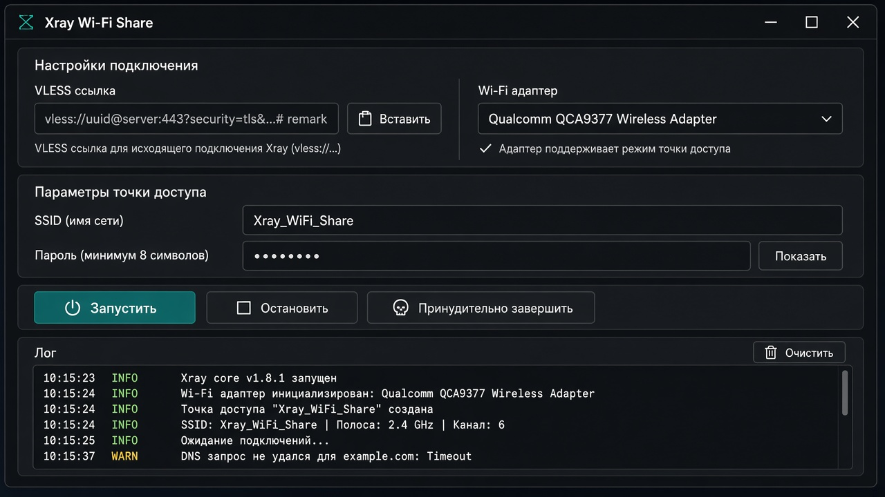

  

<h1 align="center">Xray Wi‑Fi Share</h1>

  <b>Раздай свой VPN как обычную Wi‑Fi сеть</b> 
  VLESS · Hysteria2 · Remnawave JSON · URL подписки 
  Подключай телефон, приставку, ноутбук без VPN‑клиента на них.

  
  
  

---

## Как это выглядит

  

## Что делает программа

1. Берёт твою ссылку, URL подписки или Raw JSON (Remnawave / Happ)
2. Показывает список серверов — выбираешь нужный
3. Поднимает на компьютере отдельный VPN‑туннель
4. Раздаёт его как Wi‑Fi точку через USB‑адаптер
5. Устройства в этой сети ходят в интернет уже через VPN

Компьютер при этом продолжает пользоваться своим обычным интернетом — раздача не «перехватывает» весь ПК.

## Что нужно

- Windows 10 / 11
- USB Wi‑Fi адаптер, который умеет раздавать сеть (SoftAP / hosted network)
- Один из вариантов ключа:
  - `vless://...` или `hysteria2://...` / `hy2://...`
  - URL подписки, например `https://sub.example.com/xxxxx`
  - Raw JSON Remnawave с `resolvedProxyConfigs`
- Права администратора: приложение **само запрашивает UAC при старте**

## Установка

1. Скачай установщик из [Releases](https://github.com/RasmusVraa/xray-wifi-share/releases/latest):  
   **`XrayWifiShare-Setup-1.1.5.exe`**
2. Установи как обычную программу
3. Запусти **Xray Wi‑Fi Share** из меню Пуск (подтверди UAC)

> Portable‑сборка без установщика тоже есть в релизе: `XrayWifiShare-portable-1.1.5.zip`.

## Быстрый старт

1. Вставь ссылку / URL подписки / Raw JSON  
   (кнопка **Вставить** или `Ctrl+V`)
2. Нажми **Загрузить** — появится список серверов
3. Выбери сервер в выпадающем списке
4. Выбери USB Wi‑Fi адаптер
5. Задай имя сети и пароль (минимум 8 символов)
6. Нажми **Запустить** и подтверди UAC
7. На другом устройстве подключись к этой Wi‑Fi сети

Готово: трафик устройства идёт через выбранный сервер.

## Подписки и JSON

| Формат | Что делать |
|---|---|
| `vless://` / `hy2://` | Вставь → **Загрузить** (в списке будет один сервер) |
| `https://sub…` | Вставь URL → **Загрузить** → выбери сервер |
| Remnawave Raw JSON | Вставь целиком JSON с `resolvedProxyConfigs` → **Загрузить** |

В списке показываются доступные ноды (VLESS, Hysteria2, Shadowsocks и др.).  
Скрытые и отключённые серверы пропускаются.

## Кнопки

| Кнопка | Зачем |
|---|---|
| **Вставить** | Взять ключ / URL / JSON из буфера |
| **Загрузить** | Разобрать подписку и обновить список серверов |
| **Запустить** | Запустить раздачу выбранного сервера |
| **Остановить** | Корректно выключить точку и туннель |
| **Принудительно завершить** | Аварийно снести зависшую раздачу |
| **Показать** | Показать / скрыть пароль Wi‑Fi |
| **↻** | Перечитать список Wi‑Fi адаптеров |
| **Краткий / Debug** | Режим лога: только важное или подробный вывод |

## Лог

- **Краткий** — как на скрине: `время  INFO/WARN  сообщение`
- **Debug** — плюс сырой вывод Xray / tun2socks

## Что сохраняется

Имя сети, пароль, ссылка/URL, адаптер, сервер и режим лога запоминаются  
(в `%AppData%\XrayWifiShare\settings.json`).

## Частые вопросы

**Устройство подключилось к Wi‑Fi, но сайты не открываются**  
Проверь, что в логе есть строка про успешную раздачу (`Раздача включена`). Нажми **Принудительно завершить**, затем снова **Запустить**. Попробуй другой сервер из списка.

**Список серверов пустой**  
Для URL подписки нужен интернет. Если панель отдаёт только Happ‑формат, вставь Raw JSON из клиента. Нажми **Загрузить** ещё раз.

**Не находится Wi‑Fi адаптер**  
Подключи USB‑адаптер, установи драйвер, нажми **↻**.  
Дешёвые no‑name адаптеры иногда не умеют режим точки доступа.

**Нужно ли держать программу открытой?**  
Да, пока раздача активна. Перед выходом лучше нажать **Остановить**.

**Это клиент для телефона?**  
Нет. Это раздача VPN с Windows‑ПК на другие устройства по Wi‑Fi.

## Безопасность

- Не публикуй ссылки, URL подписки и Raw JSON
- Используй нормальный пароль на Wi‑Fi точку
- После тестовых сессий меняй пароль, если он светился на экране

## Скачать

👉 [Последний релиз](https://github.com/RasmusVraa/xray-wifi-share/releases/latest)

---

  Windows · VLESS · Hysteria2 · Remnawave · SoftAP

